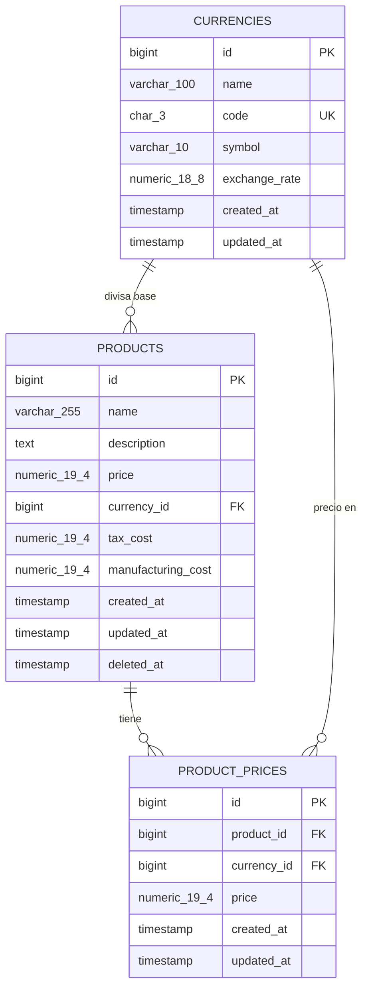

# Products API

[English](README.md) · **Español**

API RESTful desarrollada con Laravel 13 para gestionar productos y sus precios en múltiples divisas.

[](https://github.com/gerardorosetti/products-api/actions/workflows/ci.yml)

## Contenido

- [Descripción general](#descripción-general)
- [Stack tecnológico](#stack-tecnológico)
- [Inicio rápido con Docker](#inicio-rápido-con-docker)
- [Ejecución sin Docker (standalone)](#ejecución-sin-docker-standalone)
- [Credenciales de prueba](#credenciales-de-prueba)
- [Autenticación](#autenticación)
- [Endpoints](#endpoints)
- [Ejemplos de uso](#ejemplos-de-uso)
- [Formato de errores](#formato-de-errores)
- [Modelo de datos](#modelo-de-datos)
- [Decisiones técnicas](#decisiones-técnicas)
- [Seguridad](#seguridad)
- [Calidad y pruebas](#calidad-y-pruebas)
- [Documentación de la API](#documentación-de-la-api)
- [Estructura del proyecto](#estructura-del-proyecto)
- [Flujo de trabajo en Git](#flujo-de-trabajo-en-git)

## Descripción general

Products API permite crear, consultar, actualizar y eliminar productos, así como registrar sus precios en diferentes divisas. Los montos se almacenan con tipos decimales exactos (sin errores de redondeo) y el acceso se controla mediante roles y políticas.

Endpoints requeridos por la prueba:

- `GET /products`: listado paginado de productos con filtros y ordenamiento.
- `POST /products`: crear un producto con su divisa base y, opcionalmente, precios adicionales.
- `GET /products/{id}`: detalle del producto, incluyendo su divisa y precios.
- `PUT /products/{id}`: reemplazo completo de un producto.
- `DELETE /products/{id}`: eliminar un producto mediante borrado lógico (*soft delete*).
- `GET /products/{id}/prices`: listar los precios adicionales de un producto.
- `POST /products/{id}/prices`: agregar un precio en otra divisa a un producto.

Endpoints adicionales:

- Autenticación: `POST /auth/login`, `POST /auth/logout`, `GET /auth/me`.
- Gestión de divisas: `GET /currencies`, `POST /currencies`, `GET /currencies/{id}`, `PUT /currencies/{id}`, `PATCH /currencies/{id}`, `DELETE /currencies/{id}`.
- Actualización parcial de producto: `PATCH /products/{id}`.
- Estado del servicio: `GET /health`.

## Stack tecnológico

- PHP `^8.3` (la imagen de Docker utiliza PHP 8.4 FPM en Alpine)
- Framework: Laravel 13 (`laravel/framework ^13.17`)
- Autenticación: Laravel Sanctum (`laravel/sanctum ^4.3`)
- Roles y permisos: Spatie Laravel Permission (`spatie/laravel-permission ^8.3`)
- Documentación OpenAPI: Scramble (`dedoc/scramble ^0.13.52`, OpenAPI 3.1)
- Base de datos: PostgreSQL 16 (`postgres:16-alpine`)
- Servidor web: nginx (`nginx:stable-alpine`)
- Pruebas: Pest (`pestphp/pest ^4.7`, `pestphp/pest-plugin-laravel ^4.1`)
- Análisis estático: Larastan nivel 8 (`larastan/larastan ^3.13`)
- Estilo de código: Laravel Pint (`laravel/pint ^1.27`)
- Orquestación: Docker Compose
- Integración continua: GitHub Actions

## Inicio rápido con Docker

El único requisito es Docker. Un solo comando inicia la base de datos, el servidor web y el entorno de ejecución de PHP:

```bash
docker compose up -d --build
```

Una vez que los contenedores estén en ejecución:

- API: `http://localhost:8080/api`
- Documentación interactiva (Scramble): `http://localhost:8080/docs/api`

El punto de entrada del contenedor (`docker/php/entrypoint.sh`) crea `.env` a partir de `.env.example` si no existe, genera la `APP_KEY`, espera a PostgreSQL, ejecuta las migraciones pendientes y, cuando `APP_SEED=true` (el valor por defecto en `docker-compose.yml`), ejecuta los seeders. Los seeders son idempotentes, por lo que reiniciar el stack no duplica datos.

Pruebas y verificaciones dentro del contenedor:

| Tarea | Comando |
| :--- | :--- |
| Ejecutar las pruebas | `docker compose exec app php artisan test` |
| Pruebas con cobertura | `docker compose exec app php artisan test --coverage` |
| Estilo de código | `docker compose exec app vendor/bin/pint --test` |
| Análisis estático | `docker compose exec app vendor/bin/phpstan analyse --memory-limit=1G` |

Las pruebas utilizan una base de datos `testing` independiente, por lo que nunca modifican los datos de desarrollo.

Para detener el stack y eliminar sus volúmenes:

```bash
docker compose down -v
```

## Ejecución sin Docker (standalone)

Requisitos: PHP 8.3 o superior con la extensión `pdo_sqlite` (además de las extensiones requeridas por Laravel) y Composer. Este modo utiliza SQLite y no requiere un servidor de base de datos.

1. Instalar las dependencias:
   ```bash
   composer install
   ```
2. Preparar el entorno:
   ```bash
   composer setup
   ```
   Esto copia `.env.example` a `.env`, genera la `APP_KEY`, crea `database/database.sqlite` y ejecuta las migraciones y seeders.
3. Iniciar el servidor de desarrollo:
   ```bash
   php artisan serve
   ```
   La API estará disponible en `http://localhost:8000/api`.

> La suite de pruebas automatizadas se ejecuta contra PostgreSQL. Usar Docker (o el pipeline de CI) para ejecutarla.

## Credenciales de prueba

Los seeders crean dos usuarios:

| Email | Contraseña por defecto | Rol | Permisos |
| :--- | :--- | :--- | :--- |
| `admin@example.com` | `Password123!` | `admin` | Todo: `currencies.view`, `currencies.manage`, `products.view`, `products.create`, `products.update`, `products.delete`, `prices.create`. |
| `viewer@example.com` | `Password123!` | `viewer` | Solo lectura: `products.view`, `currencies.view`. |

La contraseña por defecto se puede modificar mediante la variable de entorno `SEED_USER_PASSWORD`.

> **Advertencia:** `APP_DEBUG=true` (en `.env.example` y `docker-compose.yml`) y los usuarios creados por los seeders con una contraseña conocida son valores por defecto para **desarrollo**. En producción se debe usar `APP_DEBUG=false`, configurar `SEED_USER_PASSWORD` o eliminar dichos usuarios (consulte [SECURITY.es.md](SECURITY.es.md)).

## Autenticación

La autenticación utiliza tokens de acceso personal opacos emitidos por Laravel Sanctum. Cada token incluye los permisos del usuario en forma de habilidades (*abilities*), y las políticas requieren ambas condiciones: el usuario debe tener el permiso **y** el token debe incluirlo como habilidad. Un token emitido con menos habilidades queda limitado a ellas.

Iniciar sesión:

```bash
curl -s -X POST http://localhost:8080/api/auth/login \
  -H "Accept: application/json" \
  -H "Content-Type: application/json" \
  -d '{"email":"admin@example.com","password":"Password123!"}'
```

Respuesta:

```json
{
  "data": {
    "token": "1|<token>",
    "token_type": "Bearer",
    "expires_at": "2026-11-04T02:23:52+00:00",
    "user": {
      "id": 1,
      "name": "Admin User",
      "email": "admin@example.com",
      "roles": ["admin"],
      "permissions": ["currencies.manage", "currencies.view", "prices.create", "products.create", "products.delete", "products.update", "products.view"]
    }
  }
}
```

Enviar el token en cada petición posterior:

```http
Authorization: Bearer <token>
```

- Expiración: `SANCTUM_TOKEN_EXPIRATION`, en minutos (por defecto `1440`, 24 horas).
- Cierre de sesión: `POST /auth/logout` revoca únicamente el token utilizado en esa petición y devuelve `204 No Content`.
- Los tokens expirados son eliminados diariamente mediante el comando programado `sanctum:prune-expired`. El programador de tareas debe estar en ejecución (`php artisan schedule:work`, o una entrada cron que ejecute `schedule:run`).

## Endpoints

Todas las rutas utilizan el prefijo `/api`, el cual se puede modificar mediante la variable de entorno `API_PREFIX` (por ejemplo `api/v1`, o un valor vacío para no usar prefijo).

| Método | Ruta | Permiso | Descripción |
| :--- | :--- | :--- | :--- |
| `GET` | `/health` | Público | Estado de la aplicación y de la base de datos. |
| `POST` | `/auth/login` | Público | Emite un bearer token. Con limitación de peticiones (`throttle:login`). |
| `POST` | `/auth/logout` | Autenticado | Revoca el token actual. |
| `GET` | `/auth/me` | Autenticado | Usuario actual con roles y permisos. |
| `GET` | `/currencies` | `currencies.view` | Todas las divisas, ordenadas por código. |
| `POST` | `/currencies` | `currencies.manage` | Crea una divisa (código ISO 4217 en mayúsculas y tasa de cambio). |
| `GET` | `/currencies/{id}` | `currencies.view` | Detalle de la divisa. |
| `PUT` | `/currencies/{id}` | `currencies.manage` | Reemplaza todos los campos de una divisa. |
| `PATCH` | `/currencies/{id}` | `currencies.manage` | Actualiza únicamente los campos enviados. |
| `DELETE` | `/currencies/{id}` | `currencies.manage` | Elimina una divisa (`409 Conflict` si algún producto o precio la utiliza). |
| `GET` | `/products` | `products.view` | Listado paginado con búsqueda, filtros por divisa y rango de precios, y ordenamiento. |
| `POST` | `/products` | `products.create` | Crea un producto y sus precios adicionales opcionales en una sola transacción. |
| `GET` | `/products/{id}` | `products.view` | Detalle del producto con su divisa base y precios adicionales. |
| `PUT` | `/products/{id}` | `products.update` | Reemplaza un producto (todos los campos son requeridos). |
| `PATCH` | `/products/{id}` | `products.update` | Actualiza únicamente los campos enviados. |
| `DELETE` | `/products/{id}` | `products.delete` | Realiza el borrado lógico (*soft delete*) de un producto. |
| `GET` | `/products/{id}/prices` | `products.view` | Precios adicionales de un producto. |
| `POST` | `/products/{id}/prices` | `prices.create` | Agrega un precio en otra divisa. |

## Ejemplos de uso

### Crear un producto con precios adicionales

```bash
curl -s -X POST http://localhost:8080/api/products \
  -H "Authorization: Bearer <token>" \
  -H "Accept: application/json" \
  -H "Content-Type: application/json" \
  -d '{
    "name": "Professional Monitor 27",
    "description": "4K IPS panel with factory calibration.",
    "price": "450.00",
    "currency_id": 1,
    "tax_cost": "72.00",
    "manufacturing_cost": "210.00",
    "prices": [
      {
        "currency_id": 2,
        "price": "415.50"
      }
    ]
  }'
```

Los montos (`price`, `tax_cost`, `manufacturing_cost`, `exchange_rate`) pueden enviarse como cadenas decimales (recomendado) o como números JSON. Ambas formas conservan la precisión total, pero las cadenas evitan redondeos en el cliente. Los montos admiten hasta dos decimales (`exchange_rate` hasta ocho). Las peticiones `PATCH` deben incluir al menos un campo actualizable.

### Listar productos con filtros y ordenamiento

```bash
curl -s "http://localhost:8080/api/products?search=Monitor&currency_id=1&min_price=100&max_price=500&sort=-price&per_page=15&page=1" \
  -H "Authorization: Bearer <token>" \
  -H "Accept: application/json"
```

| Parámetro | Descripción |
| :--- | :--- |
| `search` | Texto no sensible a mayúsculas en el nombre o descripción. `%` y `_` se tratan como caracteres literales. |
| `currency_id` | Divisa base del producto. |
| `min_price`, `max_price` | Rango de precios en la divisa base; cualquiera de los dos puede utilizarse por separado. |
| `sort` | `name`, `-name`, `price`, `-price`, `created_at`, `-created_at` (por defecto `-created_at`). |
| `per_page` | Tamaño de página, de 1 a 100 (por defecto 15). |
| `page` | Número de página. |

La respuesta contiene `data`, además de los bloques de paginación estándar de Laravel: `links` (`first`, `last`, `prev`, `next`) y `meta` (`current_page`, `last_page`, `per_page`, `total`, …).

### Agregar un precio en otra divisa

```bash
curl -s -X POST http://localhost:8080/api/products/1/prices \
  -H "Authorization: Bearer <token>" \
  -H "Accept: application/json" \
  -H "Content-Type: application/json" \
  -d '{
    "currency_id": 3,
    "price": "360.00"
  }'
```

### Respuesta de ejemplo (producto)

Los montos se devuelven como cadenas con exactamente dos decimales:

```json
{
  "data": {
    "id": 1,
    "name": "Professional Monitor 27",
    "description": "4K IPS panel with factory calibration.",
    "price": "450.00",
    "currency_id": 1,
    "currency": {
      "id": 1,
      "name": "US Dollar",
      "code": "USD",
      "symbol": "$",
      "exchange_rate": "1.00000000"
    },
    "tax_cost": "72.00",
    "manufacturing_cost": "210.00",
    "prices": [
      {
        "id": 1,
        "product_id": 1,
        "currency_id": 2,
        "currency": {
          "id": 2,
          "name": "Euro",
          "code": "EUR",
          "symbol": "€",
          "exchange_rate": "0.92000000"
        },
        "price": "415.50"
      }
    ],
    "created_at": "2026-11-02T20:00:00+00:00",
    "updated_at": "2026-11-02T20:00:00+00:00"
  }
}
```

## Formato de errores

Cada respuesta de error utiliza el mismo envoltorio JSON:

```json
{
  "message": "The price currency cannot be the product base currency.",
  "code": "validation_failed",
  "errors": {
    "currency_id": [
      "The price currency cannot be the product base currency."
    ]
  }
}
```

Estados HTTP y valores de `code` generados por `ApiExceptionRenderer`:

| Estado HTTP | `code` | Causa |
| :--- | :--- | :--- |
| `401 Unauthorized` | `unauthenticated` | Token ausente, inválido, revocado o expirado. |
| `403 Forbidden` | `forbidden` | El usuario o el token no poseen el permiso requerido. |
| `404 Not Found` | `not_found` | El recurso no existe o el producto fue eliminado. |
| `405 Method Not Allowed` | `method_not_allowed` | La ruta no admite el método HTTP. |
| `409 Conflict` | `currency_in_use` | La divisa está en uso por un producto o precio y no puede eliminarse. |
| `409 Conflict` | `conflict` | Una restricción de base de datos (única o clave foránea) rechazó la petición tras la validación, por ejemplo en una condición de carrera entre dos peticiones. |
| `422 Unprocessable Entity` | `validation_failed` | La validación falló. Incluye el objeto `errors`, por campo. |
| `429 Too Many Requests` | `too_many_requests` | Límite de peticiones excedido. Incluye la cabecera `Retry-After`. |
| `500 Internal Server Error` | `server_error` | Error inesperado. Los detalles se ocultan cuando `APP_DEBUG=false`. |
| Cualquier otro estado HTTP | `http_error` | Otras excepciones HTTP. |

## Modelo de datos



## Decisiones técnicas

- **Decimales exactos (`numeric(19,4)` y `numeric(18,8)`).** Los montos viajan como cadenas en JSON y la aritmética utiliza `Brick\Math\BigDecimal`, nunca `float`. Se descartaron los centavos enteros porque no se ajustan a divisas con diferentes unidades menores, ni a tasas de cambio con ocho decimales; el punto flotante pierde precisión.
- **Los precios adicionales los define el negocio.** Los precios en `product_prices` se almacenan explícitamente, no se calculan a partir de `exchange_rate`, permitiendo que cada mercado tenga su propia fijación de precios. `exchange_rate` es un dato de referencia relativo al USD (las tasas de los seeders son ilustrativas).
- **Divisa base y un único precio por divisa.** Un producto no puede tener un precio adicional en su propia divisa base (`422`), y solo puede tener un precio por divisa (índice único en `product_id, currency_id`).
- **Borrado lógico (*soft delete*).** Los productos eliminados permanecen en la base de datos para historial y auditoría, y la API responde `404` ante ellos.
- **IDs enteros autoincrementales.** Siguen el modelo de datos de la prueba técnica. La enumeración de IDs se mitiga mediante autenticación obligatoria, políticas y limitación de peticiones.
- **`code` ISO 4217 en divisas.** El enunciado describe `name` como el identificador único; se añadió el código ISO de tres letras en mayúsculas por ser el identificador estándar para divisas.
- **PUT vs PATCH.** `PUT` reemplaza el recurso y requiere todos los campos; `PATCH` actualiza únicamente los campos enviados.
- **Controladores delgados y capas.** Cada petición sigue el flujo `FormRequest -> Action -> Resource`. La autorización reside únicamente en las políticas, y los controladores nunca consultan la base de datos directamente (garantizado mediante pruebas de arquitectura).
- **Sin Redis.** La caché, las sesiones y la limitación de peticiones utilizan el controlador `database`. Una sola instancia no obtiene beneficios de Redis, por lo que solo añadiría infraestructura innecesaria.
- **Usuarios de contenedores.** El contenedor de desarrollo ejecuta PHP-FPM como `root` (`php-fpm -R`) para permitir la escritura en bind mounts sobre Docker Desktop (Windows/macOS). El objetivo de producción (`--target prod`) se ejecuta bajo el usuario sin privilegios `www-data`.

## Seguridad

La API combina tokens con expiración, control de acceso basado en roles mediante políticas, protección contra asignación masiva, limitación de peticiones, protección contra la enumeración de usuarios en el inicio de sesión, cabeceras estrictas en nginx y escaneo de dependencias y secretos en CI. Consulte [SECURITY.es.md](SECURITY.es.md) para más detalles y recomendaciones de producción.

## Calidad y pruebas

- **Suite de pruebas con Pest:** pruebas de integración (*feature tests*) (`tests/Feature/`), pruebas unitarias (`tests/Unit/`) y pruebas de arquitectura (`tests/Arch/`). Las pruebas de arquitectura verifican tipos estrictos, clases finales y de solo lectura, ausencia de llamadas de depuración y ausencia de conversiones a `float`.
- **Cobertura:** el CI falla si la cobertura de líneas es inferior al 90%.
- **Análisis estático:** Larastan nivel 8.
- **Estilo de código:** Laravel Pint.
- **Integración continua (GitHub Actions)**, en cada push a `main` y `develop` y en cada pull request:
  - **Calidad:** Pint, Larastan, `composer audit` y escaneo con `gitleaks` de todo el historial de git.
  - **Pruebas:** PHP 8.3, 8.4 y 8.5 contra PostgreSQL 16, con el umbral de cobertura en PHP 8.4. PHP 8.3 es la versión mínima permitida por `composer.json`, 8.4 es la versión de la imagen de Docker y 8.5 es la última versión disponible.
  - **Modo standalone:** `composer setup` con SQLite, seguido de una prueba de humo (*smoke test*) contra `php artisan serve`.
  - **Stack de Docker:** construye e inicia el stack, ejecuta pruebas de humo (admin y viewer), verifica las cabeceras de seguridad, ejecuta la colección de Postman con Newman, comprueba que `docs/openapi.json` esté actualizado y construye la imagen de producción.

## Documentación de la API

- **Interfaz de Scramble:** `http://localhost:8080/docs/api` (la especificación en JSON está en `/docs/api.json`). Es pública y de solo lectura.
- **Especificación OpenAPI 3.1:** exportada en `docs/openapi.json`. Para regenerarla:
  ```bash
  docker compose exec -e APP_URL=http://localhost:8080 app php artisan scramble:export --path=docs/openapi.json
  ```
- **Colección de Postman:** `docs/postman/products-api.postman_collection.json`, con el entorno `docs/postman/local.postman_environment.json`.

La colección se ejecuta en orden contra una base de datos recién inicializada con seeders (`docker compose exec app php artisan migrate:fresh --seed`). Para ejecutarla con Newman, si cuenta con Node:

```bash
npx newman run docs/postman/products-api.postman_collection.json -e docs/postman/local.postman_environment.json
```

O sin Node, utilizando la imagen oficial de Newman conectada a la red de Docker Compose:

```bash
docker run --rm --network products-api_default -v "$(pwd)/docs/postman:/etc/newman" postman/newman:6-alpine run products-api.postman_collection.json -e local.postman_environment.json --env-var base_url=http://nginx/api
```

## Estructura del proyecto

```text
app/
├── Actions/                 Acciones de negocio de un solo propósito y transacciones
├── Enums/                   Roles y permisos tipados
├── Exceptions/              Renderizador de errores de la API y excepciones de dominio
├── Http/
│   ├── Controllers/Api/     Controladores delgados que delegan en acciones y resources
│   ├── Requests/            Form requests con validación y autorización
│   └── Resources/           Transformadores JSON
├── Models/                  Modelos Eloquent, relaciones, casts y scopes
├── Policies/                Políticas de autorización
├── Providers/               Configuración de servicios, limitadores de peticiones y gates
└── Support/                 Formato de importes, reglas de validación compartidas y ajustes de OpenAPI
docker/                      Configuración de PHP, nginx y PostgreSQL
docs/                        Especificación OpenAPI y colección de Postman
tests/                       Pruebas de integración, unitarias y de arquitectura
```

## Flujo de trabajo en Git

- **Ramas (GitFlow):**
  - `main`: código estable; cada versión está etiquetada (`v1.0.0`, `v1.0.1`, …).
  - `develop`: rama de integración.
  - `feature/*`, `fix/*`, `docs/*`, `ci/*`, `chore/*`: ramas de corta duración creadas desde `develop` y fusionadas nuevamente mediante un pull request.
  - `release/*`: prepara una versión, se fusiona en `main` y de regreso en `develop`.
- **Commits:** [Conventional Commits](https://www.conventionalcommits.org/) en inglés (`feat:`, `fix:`, `docs:`, `test:`, `refactor:`, `perf:`, `build:`, `ci:`, `chore:`).
- **Cambios:** consulte [CHANGELOG.md](CHANGELOG.md).
