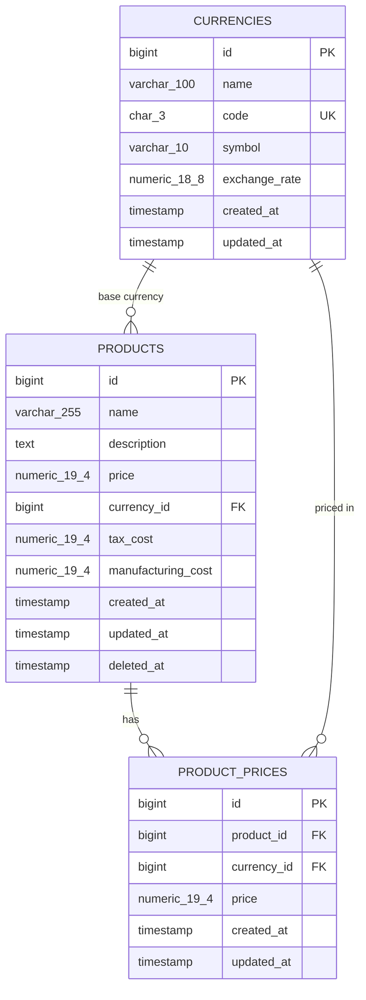

# Products API

**English** · [Español](README.es.md)

RESTful API built with Laravel 13 to manage products and their prices in multiple currencies.

[](https://github.com/gerardorosetti/products-api/actions/workflows/ci.yml)

## At a glance

- **Stack:** Laravel 13 (the current stable release; the assignment requires Laravel 8 or later), PHP 8.3+, PostgreSQL 16, Sanctum, Pest.
- **Try it in one minute:** `docker compose up -d --build`, then log in as `admin@example.com` / `Password123!` ([example](#authentication)) or open the interactive docs at `http://localhost:8080/docs/api`.
- **Quality:** feature, unit and architecture tests with a 90% minimum coverage enforced by CI, Larastan level 8 and Pint, tested on PHP 8.3, 8.4 and 8.5.
- **Why it is built this way:** see [Technical decisions](#technical-decisions).

## Contents

- [Overview](#overview)
- [Tech stack](#tech-stack)
- [Quick start with Docker](#quick-start-with-docker)
- [Running without Docker (standalone)](#running-without-docker-standalone)
- [Demo credentials](#demo-credentials)
- [Authentication](#authentication)
- [Endpoints](#endpoints)
- [Usage examples](#usage-examples)
- [Error format](#error-format)
- [Data model](#data-model)
- [Technical decisions](#technical-decisions)
- [Security](#security)
- [Quality and testing](#quality-and-testing)
- [API documentation](#api-documentation)
- [Project structure](#project-structure)
- [Git workflow](#git-workflow)

## Overview

Products API lets you create, read, update and delete products and register their prices in different currencies. Amounts are stored with exact decimal types (no rounding errors) and access is controlled with roles and policies.

Endpoints required by the assignment:

- `GET /products`: paginated product list with filters and sorting.
- `POST /products`: create a product with its base currency and, optionally, additional prices.
- `GET /products/{id}`: product details, including its currency and prices.
- `PUT /products/{id}`: fully replace a product.
- `DELETE /products/{id}`: delete a product (soft delete).
- `GET /products/{id}/prices`: list the additional prices of a product.
- `POST /products/{id}/prices`: add a price in another currency to a product.

Additional endpoints:

- Authentication: `POST /auth/login`, `POST /auth/logout`, `GET /auth/me`.
- Currency management: `GET /currencies`, `POST /currencies`, `GET /currencies/{id}`, `PUT /currencies/{id}`, `PATCH /currencies/{id}`, `DELETE /currencies/{id}`.
- Partial product update: `PATCH /products/{id}`.
- Service health: `GET /health`.

## Tech stack

- PHP `^8.3` (the Docker image uses PHP 8.4 FPM on Alpine)
- Framework: Laravel 13 (`laravel/framework ^13.17`)
- Authentication: Laravel Sanctum (`laravel/sanctum ^4.3`)
- Roles and permissions: Spatie Laravel Permission (`spatie/laravel-permission ^8.3`)
- OpenAPI documentation: Scramble (`dedoc/scramble ^0.13.52`, OpenAPI 3.1)
- Database: PostgreSQL 16 (`postgres:16-alpine`)
- Web server: nginx (`nginx:stable-alpine`)
- Testing: Pest (`pestphp/pest ^4.7`, `pestphp/pest-plugin-laravel ^4.1`)
- Static analysis: Larastan level 8 (`larastan/larastan ^3.13`)
- Code style: Laravel Pint (`laravel/pint ^1.27`)
- Orchestration: Docker Compose
- Continuous integration: GitHub Actions

## Quick start with Docker

The only requirement is Docker. One command starts the database, the web server and the PHP runtime:

```bash
docker compose up -d --build
```

Once the containers are up:

- API: `http://localhost:8080/api`
- Interactive documentation (Scramble): `http://localhost:8080/docs/api`

The container entrypoint (`docker/php/entrypoint.sh`) creates `.env` from `.env.example` if it is missing, generates `APP_KEY`, waits for PostgreSQL, runs pending migrations and, when `APP_SEED=true` (the default in `docker-compose.yml`), runs the seeders. The seeders are idempotent, so restarting the stack does not duplicate data.

Tests and checks inside the container:

| Task | Command |
| :--- | :--- |
| Run the tests | `docker compose exec app php artisan test` |
| Tests with coverage | `docker compose exec app php artisan test --coverage` |
| Code style | `docker compose exec app vendor/bin/pint --test` |
| Static analysis | `docker compose exec app vendor/bin/phpstan analyse --memory-limit=1G` |

The tests use a separate `testing` database, so they never touch the development data.

To stop the stack and remove its volumes:

```bash
docker compose down -v
```

## Running without Docker (standalone)

Requirements: PHP 8.3 or later with the `pdo_sqlite` extension (in addition to the extensions Laravel requires) and Composer. This mode uses SQLite and needs no database server.

1. Install the dependencies:
   ```bash
   composer install
   ```
2. Prepare the environment:
   ```bash
   composer setup
   ```
   This copies `.env.example` to `.env`, generates `APP_KEY`, creates `database/database.sqlite` and runs the migrations and seeders.
3. Start the development server:
   ```bash
   php artisan serve
   ```
   The API is available at `http://localhost:8000/api`.

> This mode is meant for trying the API. SQLite has no exact decimal type, so amounts with more than 15 significant digits lose precision; PostgreSQL (Docker) stores every amount exactly. For the same reason the automated test suite runs only against PostgreSQL: use Docker (or the CI pipeline) to run it.

## Demo credentials

The seeders create two users:

| Email | Default password | Role | Permissions |
| :--- | :--- | :--- | :--- |
| `admin@example.com` | `Password123!` | `admin` | Everything: `currencies.view`, `currencies.manage`, `products.view`, `products.create`, `products.update`, `products.delete`, `prices.create`. |
| `viewer@example.com` | `Password123!` | `viewer` | Read only: `products.view`, `currencies.view`. |

The default password can be changed with the `SEED_USER_PASSWORD` environment variable.

> **Warning:** `APP_DEBUG=true` (in `.env.example` and `docker-compose.yml`) and the seeded users with a known password are **development** defaults. In production use `APP_DEBUG=false`, set `SEED_USER_PASSWORD` or remove those users (see [SECURITY.md](SECURITY.md)).

## Authentication

Authentication uses opaque personal access tokens issued by Laravel Sanctum. Each token carries the user's permissions as abilities, and the policies require both: the user must have the permission **and** the token must include it as an ability. A token issued with fewer abilities is limited to them.

Log in:

```bash
curl -s -X POST http://localhost:8080/api/auth/login \
  -H "Accept: application/json" \
  -H "Content-Type: application/json" \
  -d '{"email":"admin@example.com","password":"Password123!"}'
```

Response:

```json
{
  "data": {
    "token": "1|<token>",
    "token_type": "Bearer",
    "expires_at": "2026-11-04T02:23:52+00:00",
    "user": {
      "id": 1,
      "name": "Admin User",
      "email": "admin@example.com",
      "roles": ["admin"],
      "permissions": ["currencies.manage", "currencies.view", "prices.create", "products.create", "products.delete", "products.update", "products.view"]
    }
  }
}
```

Send the token in every following request:

```http
Authorization: Bearer <token>
```

- Expiration: `SANCTUM_TOKEN_EXPIRATION`, in minutes (default `1440`, 24 hours).
- Logout: `POST /auth/logout` revokes only the token used in that request and returns `204 No Content`.
- Expired tokens are deleted daily by the scheduled `sanctum:prune-expired` command. The scheduler must be running (`php artisan schedule:work`, or a cron entry that runs `schedule:run`).

## Endpoints

All routes use the `/api` prefix, which can be changed with the `API_PREFIX` environment variable (for example `api/v1`, or an empty value for no prefix).

| Method | Path | Permission | Description |
| :--- | :--- | :--- | :--- |
| `GET` | `/health` | Public | Application and database status. |
| `POST` | `/auth/login` | Public | Issues a bearer token. Rate limited (`throttle:login`). |
| `POST` | `/auth/logout` | Authenticated | Revokes the current token. |
| `GET` | `/auth/me` | Authenticated | Current user with roles and permissions. |
| `GET` | `/currencies` | `currencies.view` | All currencies, sorted by code. |
| `POST` | `/currencies` | `currencies.manage` | Creates a currency (uppercase ISO 4217 code and exchange rate). |
| `GET` | `/currencies/{id}` | `currencies.view` | Currency details. |
| `PUT` | `/currencies/{id}` | `currencies.manage` | Replaces all the fields of a currency. |
| `PATCH` | `/currencies/{id}` | `currencies.manage` | Updates only the fields sent. |
| `DELETE` | `/currencies/{id}` | `currencies.manage` | Deletes a currency (`409 Conflict` if a product or price uses it). |
| `GET` | `/products` | `products.view` | Paginated list with search, currency and price range filters, and sorting. |
| `POST` | `/products` | `products.create` | Creates a product and its optional additional prices in one transaction. |
| `GET` | `/products/{id}` | `products.view` | Product details with its base currency and additional prices. |
| `PUT` | `/products/{id}` | `products.update` | Replaces a product (all fields required). |
| `PATCH` | `/products/{id}` | `products.update` | Updates only the fields sent. |
| `DELETE` | `/products/{id}` | `products.delete` | Soft deletes a product. |
| `GET` | `/products/{id}/prices` | `products.view` | Additional prices of a product. |
| `POST` | `/products/{id}/prices` | `prices.create` | Adds a price in another currency. |

## Usage examples

### Create a product with additional prices

```bash
curl -s -X POST http://localhost:8080/api/products \
  -H "Authorization: Bearer <token>" \
  -H "Accept: application/json" \
  -H "Content-Type: application/json" \
  -d '{
    "name": "Professional Monitor 27",
    "description": "4K IPS panel with factory calibration.",
    "price": "450.00",
    "currency_id": 1,
    "tax_cost": "72.00",
    "manufacturing_cost": "210.00",
    "prices": [
      {
        "currency_id": 2,
        "price": "415.50"
      }
    ]
  }'
```

Amounts (`price`, `tax_cost`, `manufacturing_cost`, `exchange_rate`) can be sent as decimal strings (recommended) or as JSON numbers. Both keep full precision, but strings avoid rounding on the client side. Amounts accept up to two decimals (`exchange_rate` up to eight). `PATCH` requests must include at least one updatable field.

### List products with filters and sorting

```bash
curl -s "http://localhost:8080/api/products?search=Monitor&currency_id=1&min_price=100&max_price=500&sort=-price&per_page=15&page=1" \
  -H "Authorization: Bearer <token>" \
  -H "Accept: application/json"
```

| Parameter | Description |
| :--- | :--- |
| `search` | Case-insensitive text in the name or description. `%` and `_` are treated as literal characters. |
| `currency_id` | Base currency of the product. |
| `min_price`, `max_price` | Price range in the base currency; either one can be used alone. |
| `sort` | `name`, `-name`, `price`, `-price`, `created_at`, `-created_at` (default `-created_at`). |
| `per_page` | Page size, from 1 to 100 (default 15). |
| `page` | Page number. |

The response contains `data`, plus Laravel's standard pagination blocks: `links` (`first`, `last`, `prev`, `next`) and `meta` (`current_page`, `last_page`, `per_page`, `total`, …).

### Add a price in another currency

```bash
curl -s -X POST http://localhost:8080/api/products/1/prices \
  -H "Authorization: Bearer <token>" \
  -H "Accept: application/json" \
  -H "Content-Type: application/json" \
  -d '{
    "currency_id": 3,
    "price": "360.00"
  }'
```

### Sample response (product)

Amounts are returned as strings with exactly two decimals:

```json
{
  "data": {
    "id": 1,
    "name": "Professional Monitor 27",
    "description": "4K IPS panel with factory calibration.",
    "price": "450.00",
    "currency_id": 1,
    "currency": {
      "id": 1,
      "name": "US Dollar",
      "code": "USD",
      "symbol": "$",
      "exchange_rate": "1.00000000"
    },
    "tax_cost": "72.00",
    "manufacturing_cost": "210.00",
    "prices": [
      {
        "id": 1,
        "product_id": 1,
        "currency_id": 2,
        "currency": {
          "id": 2,
          "name": "Euro",
          "code": "EUR",
          "symbol": "€",
          "exchange_rate": "0.92000000"
        },
        "price": "415.50"
      }
    ],
    "created_at": "2026-11-02T20:00:00+00:00",
    "updated_at": "2026-11-02T20:00:00+00:00"
  }
}
```

## Error format

Every error response uses the same JSON envelope:

```json
{
  "message": "The price currency cannot be the product base currency.",
  "code": "validation_failed",
  "errors": {
    "currency_id": [
      "The price currency cannot be the product base currency."
    ]
  }
}
```

HTTP statuses and `code` values produced by `ApiExceptionRenderer`:

| HTTP status | `code` | Cause |
| :--- | :--- | :--- |
| `401 Unauthorized` | `unauthenticated` | Missing, invalid, revoked or expired token. |
| `403 Forbidden` | `forbidden` | The user or the token lacks the required permission. |
| `404 Not Found` | `not_found` | The resource does not exist or the product was deleted. |
| `405 Method Not Allowed` | `method_not_allowed` | The route does not support the HTTP method. |
| `409 Conflict` | `currency_in_use` | The currency is used by a product or a price and cannot be deleted. |
| `409 Conflict` | `conflict` | A database constraint (unique or foreign key) rejected the request after validation, for example in a race between two requests. |
| `422 Unprocessable Entity` | `validation_failed` | Validation failed. Includes the `errors` object, by field. |
| `429 Too Many Requests` | `too_many_requests` | Rate limit exceeded. Includes the `Retry-After` header. |
| `500 Internal Server Error` | `server_error` | Unexpected error. Details are hidden when `APP_DEBUG=false`. |
| Any other HTTP status | `http_error` | Other HTTP exceptions. |

## Data model



## Technical decisions

- **Exact decimals (`numeric(19,4)` and `numeric(18,8)`).** Amounts travel as strings in JSON and arithmetic uses `Brick\Math\BigDecimal`, never `float`. Integer cents were ruled out because they do not fit currencies with different minor units, nor exchange rates with eight decimals; floating point loses precision. The API accepts and returns amounts with two decimals, while the columns keep four as headroom for intermediate calculations, so the precision can grow without a schema migration.
- **Additional prices are set by the business.** Prices in `product_prices` are stored explicitly, not calculated from `exchange_rate`, so each market can have its own pricing. `exchange_rate` is reference data relative to USD (the seeded rates are illustrative).
- **Base currency and one price per currency.** A product cannot have an additional price in its own base currency (`422`), and it can have only one price per currency (unique index on `product_id, currency_id`).
- **Soft deletes.** Deleted products stay in the database for history and auditing, and the API answers `404` for them.
- **Auto-increment integer IDs.** They follow the data model of the assignment. ID enumeration is mitigated by mandatory authentication, policies and rate limiting.
- **ISO 4217 `code` on currencies.** The assignment describes `name` as the unique identifier; the three-letter uppercase ISO code was added because it is the standard identifier for currencies.
- **PUT vs PATCH.** `PUT` replaces the resource and requires every field; `PATCH` updates only the fields sent.
- **Thin controllers and layers.** Every request follows `FormRequest -> Action -> Resource`. Authorization lives only in policies, and controllers never query the database directly (enforced by architecture tests).
- **No Redis.** Cache, sessions and rate limiting use the `database` driver. A single instance gains nothing from Redis, so it would only add infrastructure.
- **Container users.** The development container runs PHP-FPM as `root` (`php-fpm -R`) so it can write to bind mounts on Docker Desktop (Windows/macOS). The production target (`--target prod`) runs as the unprivileged `www-data` user.

## Security

The API combines expiring tokens, role-based access through policies, mass-assignment protection, rate limiting, protection against user enumeration on login, strict nginx headers, and dependency and secret scanning in CI. See [SECURITY.md](SECURITY.md) for details and production recommendations.

## Quality and testing

- **Pest test suite:** feature tests (`tests/Feature/`), unit tests (`tests/Unit/`) and architecture tests (`tests/Arch/`). The architecture tests check strict types, final and read-only classes, no debug calls and no `float` casts.
- **Coverage:** the CI fails below 90% line coverage.
- **Static analysis:** Larastan level 8.
- **Code style:** Laravel Pint.
- **Continuous integration (GitHub Actions)**, on every push to `main` and `develop` and on every pull request:
  - **Quality:** Pint, Larastan, `composer audit` and a `gitleaks` scan of the whole git history.
  - **Tests:** PHP 8.3, 8.4 and 8.5 against PostgreSQL 16, with the coverage gate on PHP 8.4. PHP 8.3 is the minimum version allowed by `composer.json`, 8.4 is the version of the Docker image and 8.5 is the latest release.
  - **Standalone mode:** `composer setup` with SQLite, then a smoke test against `php artisan serve`.
  - **Docker stack:** builds and starts the stack, runs smoke tests (admin and viewer), checks the security headers, runs the Postman collection with Newman, checks that `docs/openapi.json` is up to date and builds the production image.

## API documentation

- **Scramble UI:** `http://localhost:8080/docs/api` (the raw specification is at `/docs/api.json`). It is public and read-only.
- **OpenAPI 3.1 specification:** exported to `docs/openapi.json`. To regenerate it:
  ```bash
  docker compose exec -e APP_URL=http://localhost:8080 app php artisan scramble:export --path=docs/openapi.json
  ```
- **Postman collection:** `docs/postman/products-api.postman_collection.json`, with the environment `docs/postman/local.postman_environment.json`.

The collection runs in order against a freshly seeded database (`docker compose exec app php artisan migrate:fresh --seed`). To run it with Newman, if you have Node:

```bash
npx newman run docs/postman/products-api.postman_collection.json -e docs/postman/local.postman_environment.json
```

Or without Node, with the official Newman image attached to the Docker Compose network:

```bash
docker run --rm --network products-api_default -v "$(pwd)/docs/postman:/etc/newman" postman/newman:6-alpine run products-api.postman_collection.json -e local.postman_environment.json --env-var base_url=http://nginx/api
```

## Project structure

```text
app/
├── Actions/                 Single-purpose business actions and transactions
├── Enums/                   Typed roles and permissions
├── Exceptions/              API error renderer and domain exceptions
├── Http/
│   ├── Controllers/Api/     Thin controllers delegating to actions and resources
│   ├── Requests/            Form requests with validation and authorization
│   └── Resources/           JSON transformers
├── Models/                  Eloquent models, relations, casts and scopes
├── Policies/                Authorization policies
├── Providers/               Service configuration, rate limiters and gates
└── Support/                 Money formatting, shared validation rules and OpenAPI customizations
docker/                      PHP, nginx and PostgreSQL configuration
docs/                        OpenAPI specification and Postman collection
tests/                       Feature, unit and architecture tests
```

## Git workflow

- **Branches (GitFlow):**
  - `main`: stable code; every release is tagged (`v1.0.0`, `v1.0.1`, …).
  - `develop`: integration branch.
  - `feature/*`, `fix/*`, `docs/*`, `ci/*`, `chore/*`: short-lived branches created from `develop` and merged back through a pull request.
  - `release/*`: prepares a version, is merged into `main` and back into `develop`.
- **Commits:** [Conventional Commits](https://www.conventionalcommits.org/) in English (`feat:`, `fix:`, `docs:`, `test:`, `refactor:`, `perf:`, `build:`, `ci:`, `chore:`).
- **Changes:** see [CHANGELOG.md](CHANGELOG.md).
