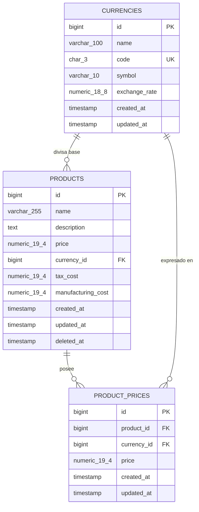

# Products API

API RESTful en Laravel 13 para gestionar productos y sus precios en múltiples divisas.

[](https://github.com/gerardorosetti/products-api/actions/workflows/ci.yml)

## Contenido

- [Resumen](#resumen)
- [Stack tecnológico](#stack-tecnológico)
- [Inicio rápido con Docker](#inicio-rápido-con-docker)
- [Ejecución sin Docker (standalone)](#ejecución-sin-docker-standalone)
- [Credenciales de prueba](#credenciales-de-prueba)
- [Autenticación](#autenticación)
- [Endpoints](#endpoints)
- [Ejemplos de uso](#ejemplos-de-uso)
- [Formato de errores](#formato-de-errores)
- [Modelo de datos](#modelo-de-datos)
- [Decisiones técnicas](#decisiones-técnicas)
- [Seguridad](#seguridad)
- [Calidad y pruebas](#calidad-y-pruebas)
- [Documentación de la API](#documentación-de-la-api)
- [Estructura del proyecto](#estructura-del-proyecto)
- [Flujo de trabajo Git](#flujo-de-trabajo-git)

## Resumen

Products API permite crear, consultar, actualizar y eliminar productos, y registrar sus precios en distintas divisas. Los importes se guardan con tipos decimales exactos (sin errores de redondeo) y el acceso se controla con roles y políticas.

Endpoints obligatorios requeridos por la consigna:
- `GET /products`: Obtener lista paginada de productos con filtros y ordenación.
- `POST /products`: Crear un nuevo producto con divisa base y precios adicionales opcionales.
- `GET /products/{id}`: Obtener el detalle de un producto por ID con sus relaciones.
- `PUT /products/{id}`: Actualizar y reemplazar por completo los datos de un producto.
- `DELETE /products/{id}`: Eliminar un producto mediante borrado lógico (*soft delete*).
- `GET /products/{id}/prices`: Obtener la lista de precios adicionales de un producto.
- `POST /products/{id}/prices`: Crear un nuevo precio adicional para un producto.

Endpoints complementarios incorporados:
- Autenticación: `POST /auth/login`, `POST /auth/logout`, `GET /auth/me`.
- Mantenimiento de divisas: `GET /currencies`, `POST /currencies`, `GET /currencies/{id}`, `PUT /currencies/{id}`, `PATCH /currencies/{id}`, `DELETE /currencies/{id}`.
- Actualización parcial de producto: `PATCH /products/{id}`.
- Estado operativo del servicio: `GET /health`.

## Stack tecnológico

- PHP: ^8.3 (entorno Docker con PHP 8.4-fpm-alpine)
- Framework: Laravel 13 (`laravel/framework ^13.17`)
- Autenticación: Laravel Sanctum (`laravel/sanctum ^4.3`)
- Autorización RBAC: Spatie Laravel Permission (`spatie/laravel-permission ^8.3`)
- Documentación OpenAPI: Scramble (`dedoc/scramble ^0.13.52`, especificación OpenAPI 3.1)
- Base de datos relacional: PostgreSQL 16 (`postgres:16-alpine`)
- Servidor web: nginx (`nginx:stable-alpine`)
- Testing: Pest (`pestphp/pest ^4.7`, `pestphp/pest-plugin-laravel ^4.1`)
- Análisis estático: Larastan nivel 8 (`larastan/larastan ^3.13`)
- Linter y formato de código: Laravel Pint (`laravel/pint ^1.27`)
- Orquestación: Docker Compose
- Integración continua: GitHub Actions

## Inicio rápido con Docker

El entorno contenedorizado inicializa automáticamente los servicios de base de datos, servidor web y runtime PHP:

```bash
docker compose up -d --build
```

Una vez levantados los contenedores:
- API disponible en: `http://localhost:8080/api`
- Documentación interactiva Scramble: `http://localhost:8080/docs/api`

El script de entrada del contenedor (`docker/php/entrypoint.sh`) espera la disponibilidad de PostgreSQL, ejecuta las migraciones pendientes y, si la variable `APP_SEED` está activa (por defecto en `docker-compose.yml`), corre los seeders automáticamente.

Comandos para pruebas y verificación dentro del contenedor:
- Ejecución de tests: `docker compose exec app php artisan test`
- Tests con reporte de cobertura: `docker compose exec app php artisan test --coverage`
- Verificación de estilo: `docker compose exec app vendor/bin/pint --test`
- Análisis estático estricto: `docker compose exec app vendor/bin/phpstan analyse --memory-limit=1G`

Para detener y destruir los contenedores junto a sus volúmenes asociados:
```bash
docker compose down -v
```

## Ejecución sin Docker (standalone)

Requisitos locales: PHP >= 8.3 con extensiones `pdo_sqlite`, `bcmath` e `intl`, además de Composer.

1. Instalar dependencias del proyecto:
   ```bash
   composer install
   ```
2. Inicializar entorno local con SQLite:
   ```bash
   composer setup
   ```
   El script copia `.env.example`, genera la clave `APP_KEY`, crea el archivo `database/database.sqlite` y aplica migraciones junto a seeders.
3. Iniciar el servidor de desarrollo:
   ```bash
   php artisan serve
   ```
   La API queda accesible en `http://localhost:8000/api`.

> Nota: La suite completa de pruebas automáticas está configurada para ejecutarse contra PostgreSQL (disponible en Docker y en el pipeline de CI).

## Credenciales de prueba

El seeder inicializa dos usuarios predeterminados asociados a roles RBAC:

| Correo electrónico | Contraseña por defecto | Rol | Permisos asignados |
| :--- | :--- | :--- | :--- |
| `admin@example.com` | `Password123!` | `admin` | Acceso total: `currencies.view`, `currencies.manage`, `products.view`, `products.create`, `products.update`, `products.delete`, `prices.create`. |
| `viewer@example.com` | `Password123!` | `viewer` | Solo lectura: consulta de catálogo y divisas (`products.view`, `currencies.view`). |

La contraseña por defecto es parametrizable mediante la variable de entorno `SEED_USER_PASSWORD`.

## Autenticación

La autenticación emplea tokens personales opacos emitidos por Laravel Sanctum cuyas habilidades reflejan los permisos del usuario.

Solicitud de inicio de sesión:
```bash
curl -s -X POST http://localhost:8080/api/auth/login \
  -H "Accept: application/json" \
  -H "Content-Type: application/json" \
  -d '{"email":"admin@example.com","password":"Password123!"}'
```

El endpoint responde con el token Bearer en `data.token` y su fecha de expiración (`data.expires_at`). Las solicitudes subsecuentes deben incluir la cabecera:
```http
Authorization: Bearer <token>
```

- Expiración: Controlada por `SANCTUM_TOKEN_EXPIRATION` en minutos (por defecto `1440` minutos = 24 horas).
- Cierre de sesión: `POST /auth/logout` revoca el token utilizado en la solicitud activa devolviendo un estado HTTP 204.

## Endpoints

El prefijo `/api` es configurable a través de la variable `API_PREFIX` en el entorno (pudiendo definirse vacío `""` o como `"api/v1"`).

| Método | Ruta | Permiso | Descripción |
| :--- | :--- | :--- | :--- |
| `GET` | `/health` | Público | Verificación del estado de la aplicación y la conexión a la base de datos. |
| `POST` | `/auth/login` | Público | Autenticación con limitador de tasa (`throttle:login`) y emisión de token Bearer. |
| `POST` | `/auth/logout` | Autenticado | Revocación del token de acceso actual. |
| `GET` | `/auth/me` | Autenticado | Información del usuario actual, incluyendo roles y permisos. |
| `GET` | `/currencies` | `currencies.view` | Listado de divisas registradas ordenadas alfabéticamente por código. |
| `POST` | `/currencies` | `currencies.manage` | Creación de divisa con código ISO 4217 en mayúsculas y tasa cambiaria. |
| `GET` | `/currencies/{id}` | `currencies.view` | Consulta detallada de una divisa por ID. |
| `PUT` | `/currencies/{id}` | `currencies.manage` | Reemplazo completo de los campos de una divisa. |
| `PATCH` | `/currencies/{id}` | `currencies.manage` | Actualización parcial de atributos enviados para una divisa. |
| `DELETE` | `/currencies/{id}` | `currencies.manage` | Eliminación de divisa (retorna 409 Conflict si está referenciada). |
| `GET` | `/products` | `products.view` | Lista paginada con filtros por texto, divisa, rango de precio y orden. |
| `POST` | `/products` | `products.create` | Creación atómica de producto y precios adicionales opcionales. |
| `GET` | `/products/{id}` | `products.view` | Detalle del producto cargando su divisa base y precios secundarios. |
| `PUT` | `/products/{id}` | `products.update` | Reemplazo total de la entidad producto (exige todos los campos). |
| `PATCH` | `/products/{id}` | `products.update` | Modificación parcial de campos específicos de un producto. |
| `DELETE` | `/products/{id}` | `products.delete` | Borrado lógico (*soft delete*) del producto. |
| `GET` | `/products/{id}/prices` | `products.view` | Lista de precios adicionales asociados al producto. |
| `POST` | `/products/{id}/prices` | `prices.create` | Registro de un precio en divisa adicional para el producto. |

## Ejemplos de uso

### Crear un producto con precios adicionales
```bash
curl -s -X POST http://localhost:8080/api/products \
  -H "Authorization: Bearer <token>" \
  -H "Accept: application/json" \
  -H "Content-Type: application/json" \
  -d '{
    "name": "Monitor Profesional 27",
    "description": "Panel IPS 4K con calibracion de fabrica.",
    "price": "450.00",
    "currency_id": 1,
    "tax_cost": "72.00",
    "manufacturing_cost": "210.00",
    "prices": [
      {
        "currency_id": 2,
        "price": "415.50"
      }
    ]
  }'
```

### Listar productos con filtros y orden
```bash
curl -s -X GET "http://localhost:8080/api/products?search=Monitor&currency_id=1&min_price=100&max_price=500&sort=-price&per_page=15&page=1" \
  -H "Authorization: Bearer <token>" \
  -H "Accept: application/json"
```

Valores permitidos en `sort`: `name`, `-name`, `price`, `-price`, `created_at`, `-created_at`. Límite máximo de `per_page`: 100.

### Registrar un nuevo precio adicional
```bash
curl -s -X POST http://localhost:8080/api/products/1/prices \
  -H "Authorization: Bearer <token>" \
  -H "Accept: application/json" \
  -H "Content-Type: application/json" \
  -d '{
    "currency_id": 3,
    "price": "360.00"
  }'
```

### Respuesta JSON de ejemplo (Producto)
Los importes monetarios se serializan como cadenas con exactamente dos cifras decimales:

```json
{
  "data": {
    "id": 1,
    "name": "Monitor Profesional 27",
    "description": "Panel IPS 4K con calibracion de fabrica.",
    "price": "450.00",
    "currency_id": 1,
    "currency": {
      "id": 1,
      "name": "US Dollar",
      "code": "USD",
      "symbol": "$",
      "exchange_rate": "1.00000000"
    },
    "tax_cost": "72.00",
    "manufacturing_cost": "210.00",
    "prices": [
      {
        "id": 1,
        "product_id": 1,
        "currency_id": 2,
        "currency": {
          "id": 2,
          "name": "Euro",
          "code": "EUR",
          "symbol": "€",
          "exchange_rate": "0.92000000"
        },
        "price": "415.50"
      }
    ],
    "created_at": "2026-11-02T20:00:00+00:00",
    "updated_at": "2026-11-02T20:00:00+00:00"
  }
}
```

## Formato de errores

Las respuestas de error en la API presentan un sobre JSON estandarizado:
```json
{
  "message": "The price currency cannot be the product base currency.",
  "code": "validation_failed",
  "errors": {
    "currency_id": [
      "The price currency cannot be the product base currency."
    ]
  }
}
```

Códigos HTTP y valores de `code` gestionados por `ApiExceptionRenderer`:

| Estado HTTP | Código (`code`) | Causa |
| :--- | :--- | :--- |
| `401 Unauthorized` | `unauthenticated` | Petición sin token Bearer válido o con token revocado/expirado. |
| `403 Forbidden` | `forbidden` | El rol del usuario carece del permiso requerido por la política. |
| `404 Not Found` | `not_found` | Recurso inexistente o producto con borrado lógico aplicado. |
| `405 Method Not Allowed` | `method_not_allowed` | Método HTTP no soportado para la ruta solicitada. |
| `409 Conflict` | `currency_in_use` | Intento de eliminación de una divisa asociada a productos o precios. |
| `422 Unprocessable Entity` | `validation_failed` | Falla en validación de FormRequest (incluye objeto `errors`). |
| `429 Too Many Requests` | `too_many_requests` | Límite de peticiones por minuto excedido (con cabecera `Retry-After`). |
| `500 Internal Server Error` | `server_error` | Excepción interna no controlada (detalles omitidos en producción). |
| Otro código HTTP | `http_error` | Excepciones HTTP genéricas capturadas. |

## Modelo de datos



## Decisiones técnicas

- **Precisión decimal exacta (`numeric(19,4)` y `numeric(18,8)`):** Se utilizan cadenas en JSON y la librería `Brick\Math\BigDecimal` en lugar de `float` o centavos enteros porque el centavo entero no escala con divisas sin submúltiplos ni con tasas de cambio de 8 decimales, y el punto flotante introduce pérdida de precisión binaria inaceptable en finanzas.
- **Precios adicionales fijados por el negocio:** Los importes en `product_prices` son explícitos y no calculados dinámicamente mediante `exchange_rate` para permitir estrategias de fijación de precios comerciales y márgenes específicos por mercado.
- **Restricción de divisa base y unicidad:** Un producto no puede registrar un precio adicional en su propia divisa base (error 422) y solo puede poseer un precio por divisa (índice único `product_id, currency_id`) para evitar ambigüedades de cotización.
- **Borrado lógico (*Soft Deletes*):** Los productos eliminados permanecen en base de datos para preservar la integridad referencial histórica en auditorías sin romper dependencias externas.
- **Identificadores enteros autoincrementales:** Se preservan los IDs enteros especificados en el enunciado; el riesgo de enumeración se mitiga con autenticación obligatoria, políticas restrictivas y limitación de tasa (*rate limiting*).
- **Inclusión de `currencies.code` (ISO 4217):** Se añadió el campo `code` de 3 letras normalizadas en mayúsculas debido a que la consigna describe `name` como identificador único, mientras que en la práctica los estándares financieros exigen código ISO.
- **Semántica PUT vs PATCH:** `PUT` ejecuta reemplazo completo exigiendo la totalidad del payload; `PATCH` admite modificaciones atómicas de subconjuntos de atributos mediante `Rules::partial`.
- **Controladores delgados y arquitectura en capas:** Flujo desacoplado `FormRequest -> Action -> Resource` donde la autorización reside exclusivamente en `Policies` y los controladores no ejecutan lógica de base de datos directa.
- **Sin dependencia de Redis:** La persistencia de caché, sesiones y límites de tasa opera sobre PostgreSQL (`database`), reduciendo la complejidad de infraestructura en instancias monolíticas.
- **Usuario de ejecución en contenedores:** El contenedor de desarrollo corre PHP-FPM como `root` (`php-fpm -R`) para permitir permisos de escritura fluidos sobre bind mounts en Docker Desktop (Windows/macOS), mientras que el target de producción (`--target prod`) opera de forma segura bajo el usuario no privilegiado `www-data`.

## Seguridad

La API incorpora defensas en profundidad: autenticación por token con expiración, control de acceso RBAC por políticas, blindaje contra asignación masiva, limitación de peticiones por minuto, protección contra enumeración de usuarios en login, cabeceras estrictas en nginx y escaneo de vulnerabilidades y secretos en CI. Consulte [SECURITY.md](SECURITY.md) para conocer los detalles y las recomendaciones de despliegue en producción.

## Calidad y pruebas

- **Suite de pruebas con Pest:** Pruebas de integración de características (`tests/Feature/`), pruebas unitarias (`tests/Unit/`) y pruebas de arquitectura (`tests/Arch/`) que verifican strict types, clases finales e inmutables, y ausencia de casts a `float`.
- **Cobertura mínima:** Configuración exigida al 90% de cobertura en la ejecución de tests.
- **Análisis estático:** Larastan configurado en nivel 8 (`phpstan analyse --memory-limit=1G`), asegurando tipado estricto en cada método.
- **Estilo de código:** Verificación de estándares mediante Laravel Pint (`pint --test`).
- **Flujo de Integración Continua (GitHub Actions):** Pipeline que ejecuta lint con Pint, análisis estático con Larastan, matriz de pruebas en PHP 8.3, 8.4 y 8.5 sobre PostgreSQL 16, prueba de humo en SQLite standalone, auditoría con `composer audit`, escaneo de secretos con `gitleaks` y construcción de imagen Docker de producción.

## Documentación de la API

- **Interfaz Scramble:** Disponible de manera interactiva sin dependencias externas en `http://localhost:8080/docs/api`.
- **Especificación OpenAPI 3.1:** Exportada y versionada en el archivo `docs/openapi.json`.
- **Colección de Postman:** Ubicada en `docs/postman/products-api.postman_collection.json` junto al entorno `docs/postman/local.postman_environment.json`.

La colección se ejecuta en orden contra una base recién sembrada (`docker compose exec app php artisan migrate:fresh --seed`). Para correrla con Newman, con Node instalado:
```bash
npx newman run docs/postman/products-api.postman_collection.json -e docs/postman/local.postman_environment.json
```

O sin Node, con la imagen oficial de Newman conectada a la red de Docker Compose:
```bash
docker run --rm --network products-api_default -v "$(pwd)/docs/postman:/etc/newman" postman/newman:6-alpine run products-api.postman_collection.json -e local.postman_environment.json --env-var base_url=http://nginx/api
```

## Estructura del proyecto

```text
app/
├── Actions/                 Acciones atómicas de lógica de negocio y transacciones
├── Enums/                   Enumeraciones tipadas para Roles y Permisos del sistema
├── Exceptions/              Manejador centralizado de errores API y excepciones de dominio
├── Http/
│   ├── Controllers/Api/     Controladores delgados delegando en Actions y Resources
│   ├── Requests/            FormRequests con reglas de validación y autorización
│   └── Resources/           Transformadores JSON y formateadores de respuesta
├── Models/                  Modelos Eloquent, relaciones, casts y scopes
├── Policies/                Políticas de autorización asociadas a modelos
├── Providers/               Configuración de servicios, RateLimiter y Gates
└── Support/                 Utilidades auxiliares (cálculo Money y reglas compartidas)
```

## Flujo de trabajo Git

- **Ramas del repositorio:**
  - `main`: Código estable de producción y versiones etiquetadas.
  - `develop`: Rama principal de integración continua.
  - `feature/*`: Desarrollo de nuevas características y endpoints.
  - `fix/*`: Correcciones de errores y bugs.
  - `chore/*`: Tareas de mantenimiento, dependencias y configuración.
  - `docs/*`: Actualizaciones de documentación y especificaciones.
  - `ci/*`: Mejoras y mantenimiento de pipelines de GitHub Actions.
- **Convención de commits:** Uso estricto de [Conventional Commits](https://www.conventionalcommits.org/) (`feat:`, `fix:`, `docs:`, `chore:`, `refactor:`, `test:`, `ci:`).
